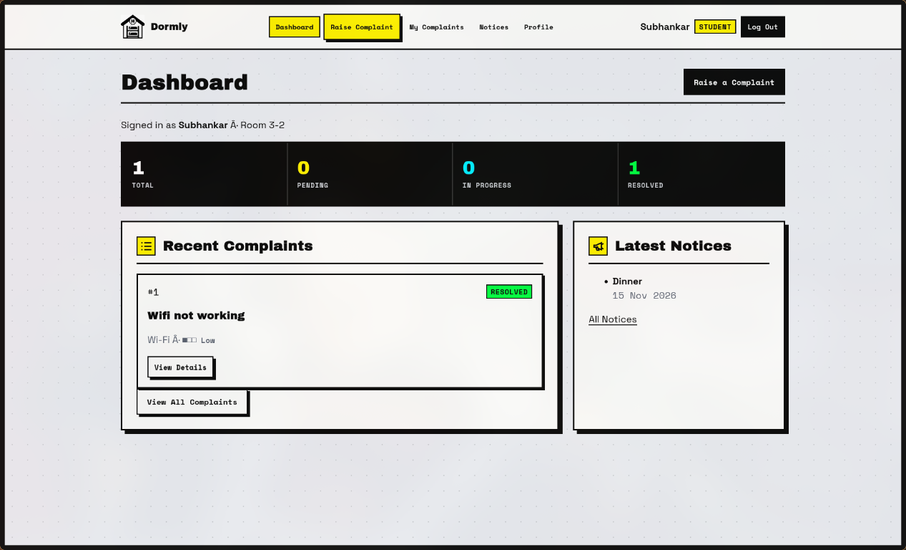

# Dormly

**Dormly** is a hostel complaint management web application for students and hostel wardens. Students can raise and track complaints, while wardens can manage complaint progress, student accounts, notices, and monthly reports.

<p align="center">
  
</p>

<p align="center">
  
</p>

<p align="center"><em>Student dashboard</em></p>

## Features

### Students

- Register with student and room details; the account waits for warden approval before sign-in.
- View a dashboard with complaint statistics and recent complaints.
- Submit complaints with a category, title, description, and optional JPG/PNG image.
- Review complaint status and its update timeline.
- Confirm resolution, reopen an eligible complaint, and submit feedback.
- Read notices published by the warden and manage their profile.

### Wardens

- View complaint, status, and overdue summaries.
- Search and filter complaints and inspect their timelines.
- Assign complaints and move them through permitted workflow states.
- Reject complaints with a reason.
- Manage student account status and post notices.
- View monthly and category-based reports, with a print view.

Complaint images are validated and stored outside the web root. The application serves them through an access-controlled endpoint rather than exposing their filesystem paths.

## Technology stack

| Area | Technology |
|---|---|
| Language | Java 17 |
| Web application | Jakarta Servlet 6, JSP, JSTL |
| Application server | Apache Tomcat 10.1 |
| Database | MySQL 8 or compatible MariaDB |
| Database access | JDBC, MySQL Connector/J |
| Build and packaging | Maven; deployable WAR |
| Browser UI | HTML, CSS, JavaScript |
| Tests | JUnit 5 |

This project uses plain Servlets, JSP, and JDBC; it does not depend on Spring or Hibernate.

## Application architecture

The application separates HTTP handling, business rules, persistence, and rendering:

```text
Browser
  -> Servlet / Filter
  -> Service
  -> DAO interface
  -> JDBC DAO implementation
  -> MySQL or MariaDB

Servlet
  -> request attributes / redirect
  -> JSP view + shared JSP tags
  -> HTML response to browser
```

- **Controllers** in `src/main/java/com/hostel/controller` handle routes, parse form data, and select views or redirects.
- **Filters** in `src/main/java/com/hostel/filter` apply UTF-8 request encoding and protect student/warden routes.
- **Services** in `src/main/java/com/hostel/service` validate input, enforce ownership and role rules, and coordinate workflows.
- **DAO interfaces and implementations** in `src/main/java/com/hostel/dao` and `dao/impl` encapsulate JDBC and SQL.
- **Models and enums** in `src/main/java/com/hostel/model` represent users, complaints, notices, priorities, and complaint states.
- **JSP views and tag files** in `src/main/webapp/WEB-INF/views` and `WEB-INF/tags` render dynamic pages and reusable UI components.
- **Static assets** in `src/main/webapp/static` include CSS, JavaScript, the Dormly logo, icons, and local fonts.

For example, the complaint workflow is enforced in [`ComplaintService`](src/main/java/com/hostel/service/ComplaintService.java), while [`ComplaintDAOImpl`](src/main/java/com/hostel/dao/impl/ComplaintDAOImpl.java) handles database operations. A status change and its timeline entry are written transactionally.

## Java and object-oriented programming

The project applies core OOP concepts to the application domain:

- **Encapsulation:** [`User`](src/main/java/com/hostel/model/User.java) and other model classes keep state in private fields and expose methods to access or change it in a controlled way.
- **Abstraction:** `User` is an abstract base type; [`ComplaintDAO`](src/main/java/com/hostel/dao/ComplaintDAO.java) and [`PriorityPolicy`](src/main/java/com/hostel/service/PriorityPolicy.java) define contracts without tying callers to implementations.
- **Inheritance:** [`Student`](src/main/java/com/hostel/model/Student.java) and [`Warden`](src/main/java/com/hostel/model/Warden.java) extend `User` with role-specific behavior and data.
- **Polymorphism:** User subtypes provide their own dashboard paths. Services depend on DAO and policy interfaces, so behavior can be supplied by different implementations.
- **Composition:** A complaint can contain its student and timeline data; services are composed with the DAOs and policy objects they need.
- **Enums with behavior:** [`ComplaintStatus`](src/main/java/com/hostel/model/enums/ComplaintStatus.java) contains status display names, open-state information, and transition rules. [`Priority`](src/main/java/com/hostel/model/enums/Priority.java) associates priorities with SLA days.

The code also demonstrates common design patterns:

- **DAO:** separates database persistence from business logic.
- **Service layer:** keeps validation and business rules out of servlets and SQL classes.
- **Strategy:** [`CategoryPriorityPolicy`](src/main/java/com/hostel/service/CategoryPriorityPolicy.java) maps complaint categories to priorities through `PriorityPolicy`.
- **Factory:** [`UserFactory`](src/main/java/com/hostel/dao/impl/UserFactory.java) constructs the appropriate `User` subtype from a database row.

## Requirements

- JDK 17 or newer.
- Maven 3.9 or newer.
- Apache Tomcat 10.1.
- MySQL 8 or a compatible MariaDB server.

On Arch Linux / Omarchy, the relevant packages are `jdk17-openjdk`, `maven`, `tomcat10`, and `mariadb`. Package names may differ on other distributions.

## Database setup

1. Start the database server.
2. Create the schema using an administrative local database account:

   ```bash
   sudo mariadb < sql/schema.sql
   ```

   For MySQL installations that use password authentication, the equivalent is:

   ```bash
   mysql -u root -p < sql/schema.sql
   ```

3. Create a restricted account for the app. Connect as the database administrator and run the following SQL, replacing the example password with a private value:

   ```sql
   CREATE USER 'hostel_app'@'localhost' IDENTIFIED BY 'replace-with-a-private-password';
   GRANT SELECT, INSERT, UPDATE, DELETE ON hostel_db.* TO 'hostel_app'@'localhost';
   ```

4. Copy the example configuration, then edit `src/main/resources/app.properties`:

   ```bash
   cp src/main/resources/app.properties.example src/main/resources/app.properties
   ```

   Set local values in the copied file:

   ```properties
   db.url=jdbc:mysql://localhost:3306/hostel_db?useSSL=false&serverTimezone=UTC
   db.user=hostel_app
   db.password=your-hostel_app-database-password
   upload.dir=/path/writable/by/tomcat/hostel-uploads
   warden.email=warden@example.com
   warden.password=your-separate-warden-login-password
   warden.name=Hostel Warden
   ```

   `db.password` is the MariaDB/MySQL account password used by Java to connect to the database. `warden.password` is a separate application sign-in password. Use private values, do not paste them into chat or public repositories, and do not package real credentials into a WAR that will be shared. The real `app.properties` file is intentionally ignored by Git; commit only the example template.

On first startup, the application creates an active warden account if the database does not already contain one. It also creates the configured upload directory. Ensure the Tomcat service account can write to that directory. If changing the warden password after the account has already been created, changing the property alone does not reset the existing database account password.

## Build and test

From the project root:

```bash
mvn test
mvn clean package
```

The resulting application archive is:

```text
target/hostel-complaint-system.war
```

## Deploy and run

Start the database and Tomcat, then copy the WAR into the Tomcat `webapps` directory. For the Arch `tomcat10` package:

```bash
sudo systemctl start mariadb tomcat10
sudo install -o tomcat10 -g tomcat10 -m 644 \
  target/hostel-complaint-system.war \
  /var/lib/tomcat10/webapps/hostel-complaint-system.war
sudo systemctl restart tomcat10
```

Open the application:

```text
http://localhost:8080/hostel-complaint-system/login
```

Tomcat translates JSPs when they are first requested. If deployment fails, inspect the Tomcat service log for application startup, database connection, upload directory, or JSP compilation errors.

## Project layout

```text
sql/schema.sql                         Database schema
src/main/java/com/hostel/
  controller/                           Servlets and shared servlet base
  dao/                                  DAO interfaces and JDBC implementations
  exception/                            Application exception types
  filter/                               Request encoding and authorization filters
  listener/                             Application startup initialization
  model/                                Domain objects and enums
  report/                               Report and filter data objects
  service/                              Business rules and workflows
  util/                                 Configuration, validation, password, and file helpers
src/main/resources/app.properties       Local application configuration
src/main/webapp/WEB-INF/views/           JSP pages
src/main/webapp/WEB-INF/tags/            Reusable JSP tags and layout
src/main/webapp/static/                  CSS, JavaScript, images, fonts
src/test/java/                           JUnit tests and demo data seeder
docs/screenshots/                        Project screenshots
```

## Demo data

[`DemoDataSeeder`](src/test/java/com/hostel/DemoDataSeeder.java) can create sample students and complaints for demonstrations. Run it only against a local/demo database: it adds records each time it is run, so repeated runs create additional data.

## Manual smoke-test checklist

After deployment, verify the main flows in a browser:

1. Sign in as the configured warden and open the dashboard, complaints, students, notices, and reports.
2. Register a student, approve the account as the warden, then sign in as the student.
3. Submit complaints with and without an image; verify the details and timeline.
4. Update a complaint as the warden, then confirm the changed status is visible to the student.
5. Add a notice and verify that it appears in the student view.
6. Check that students cannot access another student's complaint image and that reports print correctly.
